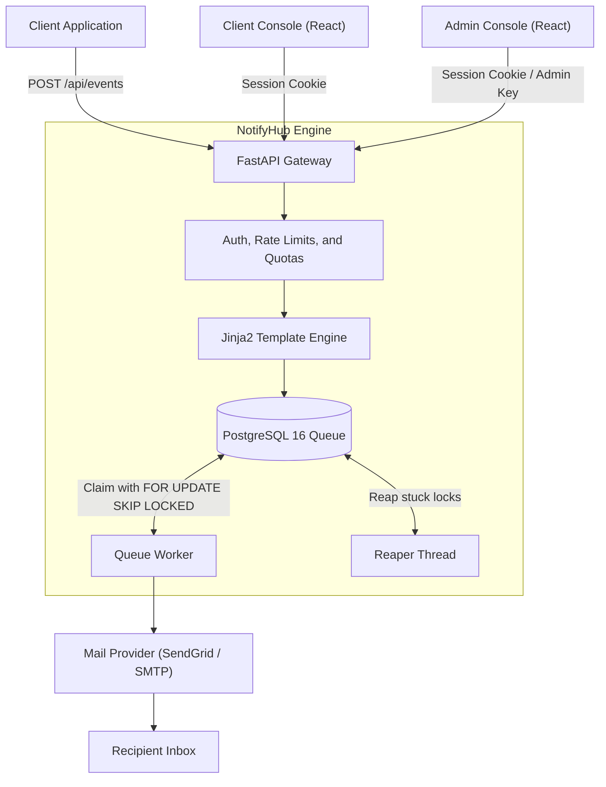
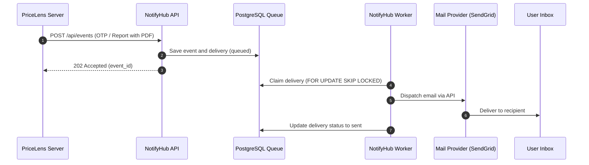

# NotifyHub

## 1. NotifyHub

Multi-tenant transactional email notification service with template rendering, durable PostgreSQL queueing, and dedicated web consoles.

Live app: https://notifyhub-umber-one.vercel.app/ 
Backend API: https://notifyhub-94r2.onrender.com/  
API docs: https://notifyhub-94r2.onrender.com/docs  

- Ingests notification events over a REST API with idempotency and rate limiting.
- Renders Jinja2 templates strictly with variable validation and version tracking.
- Queues email deliveries in PostgreSQL using brokerless worker claiming.
- Provides separate web consoles for client tenants and platform administrators.

---

## 2. Overview

Every web application needs transactional emails for account verification, password resets, and notifications. Building email delivery directly inside application code leads to duplicated template engines, unhandled provider outages, lost messages, and a lack of rate limiting. NotifyHub solves this by providing a standalone, multi-tenant notification engine behind an HTTP API. Client applications send event payloads, and NotifyHub handles rendering, queueing, retries, and provider dispatch.

---

## 3. Features

- Idempotent event ingestion using optional client Idempotency-Key headers and payload hashing.
- Priority queue ordering supporting high, normal, and low priority delivery tiers.
- Automatic retries with configurable schedules and dead-letter tracking for failed deliveries.
- Time-to-live expiration for time-sensitive emails such as login verification codes.
- Scheduled delivery allowing events to specify a future send time.
- Strict Jinja2 template rendering that rejects missing variables with HTTP 422.
- Template versioning allowing drafting, activation, and historical inspection.
- Event type definitions with configurable priority, retry schedule, TTL, and sensitivity flags.
- Recipient management with opt-out tracking per event type.
- Per-tenant API keys stored as cryptographic hashes with prefix identification.
- Quota enforcement including monthly plan limits, tenant daily limits, and global safety caps.
- Tenant rate limiting with automatic sliding-window tracking and rejection counters.
- PDF attachment validation and storage with automatic byte purging after delivery.
- Separate web management consoles for tenant owners and platform administrators.

---

## 4. Architecture



### The Path of One Email

1. A client application sends an HTTP POST request to `/api/events` with an API key, event type, recipient email, and data payload.
2. The API gateway validates the API key, checks tenant rate limits, verifies idempotency, and checks daily and monthly sending quotas.
3. The API retrieves the active template for the event type, checks recipient opt-out preferences, and strictly renders the subject and body.
4. The event and delivery records are written to PostgreSQL with a queued status, frozen content, and calculated expiration timestamp.
5. The API returns an HTTP 202 Accepted response with the event ID and initial delivery details.
6. The background worker claims pending deliveries in priority order using `SELECT ... FOR UPDATE SKIP LOCKED` and transitions them to processing.
7. The worker dispatches the email through the configured provider (SendGrid API or SMTP) within rate limits.
8. Upon successful dispatch, the delivery status is set to sent, provider message IDs are stored, and temporary attachment bytes are purged. If dispatch fails, the worker schedules a retry or marks the delivery as dead.

### Key Design Decisions

- PostgreSQL as the message queue: Uses PostgreSQL `FOR UPDATE SKIP LOCKED` queries directly, eliminating external message brokers like Redis or RabbitMQ while providing ACID durability.
- Render and freeze at intake: Template rendering occurs immediately when an event is accepted. Frozen subject and body content guarantees that future template edits never alter in-flight deliveries.
- Strict tenant isolation: Every recipient, event, template, key, and delivery is scoped to a tenant client ID in the database schema.
- Hashed API key storage: Raw API keys are shown once during creation. The database stores only the key prefix and an HMAC-SHA256 hash.
- Lock reaper: An independent reaper thread runs alongside the worker, reclaiming deliveries that remain locked past timeout limits if a worker process terminates unexpectedly.

---

## 5. Example Integration: PriceLens

PriceLens is a price analysis web app that uses NotifyHub to deliver transactional user notifications. The PriceLens backend server stores its NotifyHub API key in an environment variable and makes POST requests to `/api/events`. It sends login OTP verification codes as high-priority events with a 5-minute expiration time. It also dispatches price analysis report emails carrying generated PDF attachments to users upon completed evaluations. NotifyHub handles template rendering, durable queuing, and delivery, freeing PriceLens from managing mail servers.



Example client: https://pricelens-pi.vercel.app/

---

## 6. Tech Stack

| Layer | Technology |
| --- | --- |
| Backend API | FastAPI, Python 3.12, Pydantic v2 |
| Database & ORM | PostgreSQL 16, SQLAlchemy 2.0, Alembic |
| Database Driver | psycopg 3 |
| Queue & Concurrency | PostgreSQL FOR UPDATE SKIP LOCKED, thread-based reaper |
| Template Engine | Jinja2 with StrictUndefined |
| Authentication | Argon2id password hashing, HMAC-SHA256 tokens |
| Mail Delivery | SendGrid API v3, Python smtplib |
| Frontend Console | React 19, Vite, Plain CSS |

---

## 7. Project Structure

```
NotifyHub/
├── backend/
│   ├── alembic/       # Database migrations
│   ├── app/           # FastAPI application, routers, services, and models
│   ├── scripts/       # Database initialization and admin seed scripts
│   ├── worker/        # Queue worker, claim logic, reaper, and email providers
│   ├── Dockerfile     # Container definition for API and worker
│   └── docker-compose.yml # Local orchestration for Postgres, API, and worker
└── frontend/
    ├── public/        # Static icons and manifest files
    └── src/           # React console pages, components, API client, and styles
```

---

## 8. Getting Started

### Prerequisites

- Docker and Docker Compose
- Node.js (version 18 or higher) and npm

### 1. Start Backend Services

From the project root:

```bash
cd backend
docker compose up -d
```

This starts:
- API Server: `http://localhost:8000`
- PostgreSQL 16: `localhost:5433`
- Queue Worker: Background process inside container

### 2. Create the Administrator Account

Configure `ADMIN_EMAIL` and `ADMIN_PASSWORD` in `backend/.env`, then run the seed script:

```bash
docker compose exec api python scripts/seed.py
```

### 3. Start Frontend Console

From the project root:

```bash
cd frontend
npm install
npm run dev
```

Open `http://localhost:3000` in your browser. The Vite development server proxies API requests to `http://localhost:8000`.

---

## 9. Send Your First Email

1. Sign up for a tenant account at `<NOTIFYHUB_VERCEL_URL>/signup` or log in through the client console.
2. Navigate to the API Keys page and create an API key. Copy the key token immediately.
3. Verify or create an event type (such as `welcome_email`) on the Event Types page, and confirm an active template exists for it on the Templates page.
4. Send an HTTP POST request to `<NOTIFYHUB_RENDER_URL>/api/events` using curl:

```bash
curl -X POST "<NOTIFYHUB_RENDER_URL>/api/events" \
  -H "Content-Type: application/json" \
  -H "X-API-Key: nh_live_example_token_here" \
  -H "Idempotency-Key: demo-event-001" \
  -d '{
    "event_type": "welcome_email",
    "to": "user@example.com",
    "data": {
      "name": "Alex",
      "app_name": "DemoApp"
    }
  }'
```

5. Check the delivery status in the client console Deliveries page or query `<NOTIFYHUB_RENDER_URL>/api/deliveries`.

---

## 10. Environment Variables

| Variable | Purpose | Required |
| --- | --- | --- |
| `DATABASE_URL` | PostgreSQL connection string | Yes |
| `ADMIN_KEY` | Master secret key for administrative API endpoints | Yes |
| `HMAC_SECRET` | Secret token for hashing sensitive event payloads | Yes |
| `MAIL_PROVIDER` | Email delivery provider (sendgrid or smtp) | No (defaults to sendgrid) |
| `SENDGRID_API_KEY` | API key for SendGrid v3 mail delivery | Yes (if MAIL_PROVIDER is sendgrid) |
| `FROM_EMAIL` | Verified sender address for SendGrid | Yes (if MAIL_PROVIDER is sendgrid) |
| `SMTP_HOST` | Hostname for SMTP delivery | No (if MAIL_PROVIDER is smtp) |
| `SMTP_PORT` | Port for SMTP delivery | No (defaults to 1025) |
| `SMTP_FROM` | Sender email address for SMTP | No |
| `GLOBAL_DAILY_LIMIT` | System-wide maximum emails per UTC day | No (defaults to 90) |
| `DEFAULT_RATE_LIMIT_PER_SEC` | Default tenant intake rate limit per second | No (defaults to 50) |
| `OUTGOING_RATE_PER_SEC` | Worker delivery dispatch speed in emails per second | No (defaults to 20) |
| `WORKER_POLL_SECONDS` | Polling frequency for queue worker in seconds | No (defaults to 1) |
| `LOCK_SECONDS` | Duration a worker holds a delivery lease before reaper intervenes | No (defaults to 60) |
| `REAPER_SECONDS` | Interval for reaper loop checking stuck deliveries | No (defaults to 30) |
| `SESSION_DAYS` | Lifetime of console session cookies in days | No (defaults to 7) |
| `COOKIE_NAME` | Name of the authentication session cookie | No (defaults to nh_session) |
| `COOKIE_SECURE` | Enforces Secure flag on session cookies (set to true in production) | No (defaults to false) |
| `MAX_ACTIVE_KEYS` | Maximum active API keys allowed per tenant | No (defaults to 5) |
| `LOGIN_MAX_ATTEMPTS` | Maximum failed login attempts before throttling | No (defaults to 10) |
| `LOGIN_WINDOW_MINUTES` | Sliding window in minutes for login throttling | No (defaults to 15) |
| `ADMIN_EMAIL` | Administrator email address used by seed script | No |
| `ADMIN_PASSWORD` | Administrator password used by seed script | No |
| `ATTACHMENT_MAX_COUNT` | Maximum number of attachments allowed per event | No (defaults to 3) |
| `ATTACHMENT_MAX_TOTAL_MB` | Maximum total attachment size in megabytes | No (defaults to 5) |
| `ATTACHMENT_ALLOWED_TYPES` | Comma-separated allowed attachment MIME types | No (defaults to application/pdf) |
| `ATTACHMENT_RETENTION_DAYS` | Days to retain attachment files on dead deliveries | No (defaults to 7) |

---

## 11. API Overview

### Client Applications (Header: X-API-Key)

| Method | Endpoint | Description |
| --- | --- | --- |
| `POST` | `/api/events` | Ingest a notification event and enqueue delivery |
| `GET` | `/api/events/{event_id}` | Retrieve event intake and delivery status |
| `GET` | `/api/me` | Fetch client tenant profile and rate limits |
| `GET` | `/api/deliveries` | List deliveries with status, recipient, and date filters |
| `GET` | `/api/deliveries/{id}` | Retrieve delivery details, attempt log, and errors |
| `POST` | `/api/deliveries/{id}/retry` | Re-queue a failed delivery for reprocessing |
| `GET` | `/api/templates` | List tenant templates |
| `GET` | `/api/event-types` | List event type configuration rules |
| `GET` | `/api/recipients` | List recipients and communication preferences |
| `GET` | `/api/stats/summary` | Retrieve status counters and success rates |
| `GET` | `/api/stats/series` | Retrieve time-bucketed event and delivery analytics |
| `GET` | `/api/stats/rate` | Retrieve request rate statistics and rejection counts |

### Console (Cookie: nh_session)

| Method | Endpoint | Description |
| --- | --- | --- |
| `POST` | `/console/auth/signup` | Register a new client tenant organization and owner |
| `POST` | `/console/auth/login` | Authenticate tenant owner or platform admin |
| `POST` | `/console/auth/logout` | Clear active console session cookie |
| `GET` | `/console/auth/me` | Retrieve current authenticated user and tenant session |
| `GET` | `/console/api-keys` | List active tenant API keys |
| `POST` | `/console/api-keys` | Generate a new tenant API key (shown once) |
| `POST` | `/console/api-keys/{id}/revoke` | Revoke an existing API key immediately |
| `GET` | `/console/plan` | View assigned subscription plan, limits, and usage |
| `GET` | `/console/client` | View tenant sending identity settings |
| `PATCH` | `/console/client` | Update tenant sender name and reply-to address |
| `POST` | `/api/templates` | Create or update a template version |
| `POST` | `/api/templates/variables` | Detect template variables and generate sample preview |

### Platform Administration (Header: X-Admin-Key or Admin Session)

| Method | Endpoint | Description |
| --- | --- | --- |
| `GET` | `/admin/overview` | Platform overview metrics, queue depth, and top clients |
| `GET` | `/admin/clients` | List all registered tenants with usage and status |
| `POST` | `/admin/clients` | Manually register a new client tenant organization |
| `GET` | `/admin/clients/{id}` | Detailed tenant profile, quotas, and recent activity |
| `PATCH` | `/admin/clients/{id}` | Update tenant status (active or paused) or assign plan |
| `POST` | `/admin/clients/{id}/keys` | Generate an API key for a tenant |
| `POST` | `/admin/clients/{id}/reset-keys` | Rotate and replace a tenant API key |
| `GET` | `/admin/plans` | List available subscription plans and tenant counts |
| `POST` | `/admin/plans` | Create a new subscription tier with quotas |
| `PATCH` | `/admin/plans/{id}` | Update limits and quotas on an existing plan |
| `DELETE` | `/admin/plans/{id}` | Delete an unused subscription plan |
| `GET` | `/admin/health` | System health, worker heartbeat, and provider status |
| `GET` | `/admin/audit-logs` | Retrieve administrative audit trail entries |
| `GET` | `/admin/settings` | Read platform rate limits and global settings |
| `PATCH` | `/admin/settings` | Update system rate limits and maintenance mode |
| `POST` | `/admin/settings/test-connection` | Verify network connectivity to active mail provider |
| `POST` | `/admin/settings/test-email` | Dispatch a diagnostic email through active provider |

---

## 12. Deployment

### Architecture on Production Platforms

NotifyHub supports containerized deployment across cloud platforms:
- Frontend on Vercel: Points to `<NOTIFYHUB_VERCEL_URL>`. The `frontend/vercel.json` file configures path rewrites so that `/api`, `/console`, and `/admin` requests forward to the backend URL, preserving first-party `SameSite=Lax` cookies.
- Backend on Render: Points to `<NOTIFYHUB_RENDER_URL>`. Render runs the web service using the Dockerfile command (`uvicorn app.main:app --host 0.0.0.0 --port 8000`) and the worker as a background worker service (`python -m worker.main`). Both services connect to a managed PostgreSQL database.

### Environment Setup on Render

Configure the following variables in the Render dashboard for both API and Worker services:
- `DATABASE_URL`: Connection string to the managed PostgreSQL database.
- `ADMIN_KEY`: Random secret token for admin access.
- `HMAC_SECRET`: Random secret token for payload hashing.
- `MAIL_PROVIDER`: Set to `sendgrid`.
- `SENDGRID_API_KEY`: Production SendGrid API key.
- `FROM_EMAIL`: Verified sender email address.
- `COOKIE_SECURE`: Set to `true` for production HTTPS.
- `GLOBAL_DAILY_LIMIT`: Maximum daily delivery quota.
- `ADMIN_EMAIL` and `ADMIN_PASSWORD`: Credentials for the initial administrator user.

### Note on Free Hosting Tiers

Free hosting tiers can sleep after inactivity, so the first request after a break can be slow, and scheduled emails and retries only run while the service is awake.

---

## 13. Future Improvements

- Webhook callbacks notifying client applications of delivery outcomes (sent, bounced, dropped).
- Multi-provider automatic failover if the primary provider encounters rate limits or upstream errors.
- Visual drag-and-drop HTML email template designer alongside raw Jinja2 markup.
